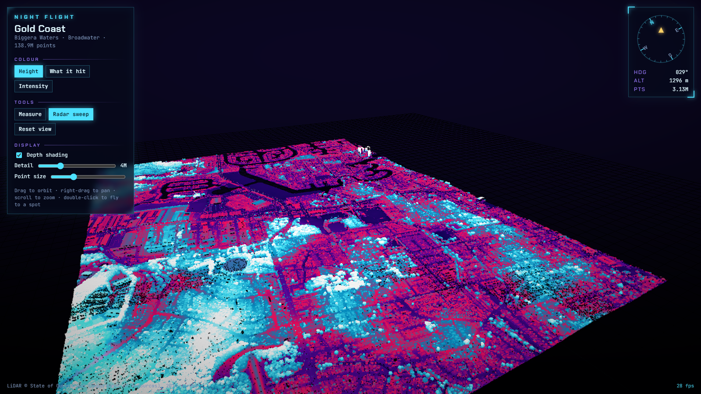

# Night Flight

**Streaming LiDAR point clouds in the browser.** 139 million points of the Gold Coast, smooth on a
laptop's integrated graphics, from a tiler and viewer written from scratch (no Potree, no CesiumJS).



**Live:** [nightflight7fe4i0.z8.web.core.windows.net](https://nightflight7fe4i0.z8.web.core.windows.net/), with the open
Autzen Stadium sample (10.6M points). The Gold Coast flight above runs on a private link that I'm
happy to share on request.

## What it does

- **Streams** a point cloud far bigger than memory: only the detail where you're looking loads, coarse everywhere else.
- **Colours** by height (a neon hypsometric ramp), by what the laser hit (ground, vegetation, buildings, water), by intensity, or by photo colour.
- **Measures**: click two points for straight-line distance, distance across the ground and height difference, with each point's latitude/longitude from the survey grid (MGA / UTM).
- **Reads like a flight**: eye-dome lighting for depth, a radar sweep, detail that materialises as it streams, and a HUD with heading, altitude and points on screen.

## How it works

**Tiler** ([`tiler/tile.py`](tiler/tile.py), Python + NumPy + laspy). Builds an octree in which every node holds an
*evenly spread sample* of its cube: one point per cell of a 128³ grid. The root alone is a coarse picture of the
whole survey, and each level down adds detail. Each point is stored exactly once, in the shallowest node that
samples it, so nothing is duplicated. A node with 20k points or fewer keeps them all and becomes a leaf.
Positions are quantised to 16 bits within their node's cube (sub-centimetre at the leaves), plus classification
and intensity: 9 bytes a point. The whole build is vectorised (`np.unique` over Morton-style keys, level by level):
139M points in 11 minutes on a laptop.

**Viewer** ([`web/src`](web/src), TypeScript + Three.js).
- [`lod.ts`](web/src/lod.ts): every frame, walk the octree biggest-on-screen first with a max-heap until the
  point budget (default 4M) is spent; queue what's missing, six requests at a time; free nodes nobody has looked
  at. The work per frame scales with what's on screen, not with the size of the cloud: ~0.2 ms for the Gold Coast.
- [`material.ts`](web/src/material.ts): point sizes adapt to the finest level drawn in each region so coarse
  samples shrink once detail lands on top of them; class filtering via a 256-entry lookup texture; eye-dome
  lighting as a full-screen pass over the depth buffer.
- [`geo.ts`](web/src/geo.ts): UTM/MGA grid to latitude and longitude on the GRS80 ellipsoid.

## Numbers (Gold Coast, 2014 survey)

| | |
|---|---|
| Area | 3 × 4 km: Biggera Waters, Anglers Paradise, Harbour Town |
| Points | 138,936,832 (about 11 per m²) |
| Octree | 16,032 nodes, 9 levels, 1.25 GB |
| Frame rate | ~30–40 fps on Intel UHD integrated graphics at 4M points on screen |

## Run it

```bash
cd tiler && uv run tile.py ../web/public/clouds/mycloud path/to/*.laz --utm 56S --title "My scan"
cd ../web && npm install && npm run dev      # then open http://localhost:5190/?cloud=mycloud
```

`web/scripts/shot.mjs` drives an installed Edge to measure real frame times and take screenshots.

## Data

- Gold Coast: LiDAR © State of Queensland (Department of Resources), SE Queensland 2014 survey, via
  [ELVIS](https://elevation.fsdf.org.au/). Not redistributed in this repository.
- Autzen Stadium sample: [PDAL sample data](https://github.com/PDAL/data).

By Elyra Software.
